# ShilpAI — AI-Driven Market Linkage & Smart Cataloging for Artisans

> **From Craft to Commerce — An AI Business Manager for Marginalized Artisans, Weavers, and Craft Clusters**

ShilpAI is a production-oriented, full-stack, voice-first, bilingual (Hindi & English) AI platform engineered specifically for Indian artisans and micro-entrepreneurs. It bridges the critical divide between generational craftsmanship and modern digital commerce through automated zero-form cataloging, image enhancement, explainable margin pricing, B2B matchmaking, QR-linked craft passports, and financial intelligence.

---

## 🏛️ System Architecture

```mermaid
flowchart TD
    subgraph Client ["Client Layer (Voice-First, Mobile-Responsive)"]
        UI["React 19 + TypeScript + Vite + Tailwind CSS"]
        Speech["Web Speech Recognition & Synthesis (Hindi / English)"]
        Scanner["Mobile QR Code Scanner (Packaging Verification)"]
    end

    subgraph Gateway ["API & Security Layer"]
        FastAPI["FastAPI 0.110+ REST API Gateway"]
        Auth["JWT Token Bearer + Bcrypt Password Hashing"]
        RBAC["Server-Side Role-Based Access Control"]
    end

    subgraph CoreServices ["ShilpAI Application Services"]
        Studio["Module A: AI Image Studio & Pillow Enhancement"]
        Catalog["Module B & C: Zero-Form Bilingual Catalog Generator"]
        Pricing["Module D: Dynamic Pricing Engine (Gross Margin Formula)"]
        Manager["Module E: Grounded AI Virtual Business Manager"]
        Matching["Module G: B2B Multi-Criteria Matchmaker"]
        Orders["Module I: Milestone & Production Allocation Tracker"]
        Passport["Module J: Digital Craft Passport & QR Minting"]
        Marketing["Module L & K: Multichannel Social Pack Generator"]
        Finances["Module S: Financial Health Assistant & Margin Auditing"]
        Schemes["Module R: Official Government Scheme Navigator"]
    end

    subgraph DataLayer ["Data & Storage Layer"]
        DB[(PostgreSQL / SQLite with SQLAlchemy ORM)]
        StaticFS[("Local Static & S3-Compatible Uploads (/uploads)")]
    end

    Client --> Gateway
    Gateway --> CoreServices
    CoreServices --> DataLayer
```



---

## 🌟 Complete Feature Suite (Modules A — T)

| Module | Feature | Implementation Details |
|---|---|---|
| **Module A** | **AI Product Studio** | Real image enhancement using Pillow: contrast (+15%), brightness (+8%), sharpness (+25%), background cleanup isolation, and living-room lifestyle mockups. |
| **Module B** | **Zero-Form Smart Cataloging** | Minimal-input listing creation: auto-extracts categories, materials, dimensions, and tags; asks conversational missing questions; generates bilingual titles and descriptions. |
| **Module C** | **Voice-First Multilingual Assistant** | Speech-to-text in Hindi and English; audio read-aloud via Web SpeechSynthesis for low-literacy artisans. |
| **Module D** | **Dynamic Pricing Assistant** | Exact formula: `Selling Price = Total Cost / (1 - Target Gross Margin % / 100)`. Displays floor, target, and boutique prices with underpricing warnings. |
| **Module E** | **AI Virtual Business Manager** | Grounded chatbot checking the authenticated artisan's actual database records (orders, inventory, expenses, revenue) with daily priorities. |
| **Module F** | **Demand Prediction & Market Trends** | Historical trends by craft category, seasonal promotion indicators, and stockout prevention alerts. |
| **Module G** | **AI B2B Buyer Matchmaking** | Criteria ranking combining craft category fit, monthly capacity vs required quantity, price point, location, and verified trust score. |
| **Module H** | **Cluster Intelligence** | Aggregated monthly capacity across GI clusters (Varanasi Silk, Kutch Rogan, Channapatna Toys, Bastar Dhokra, Jaipur Pottery). |
| **Module I** | **Bulk Order Management** | Inquiry → Quotation → Negotiation → Confirmed Order → Production allocations → Milestones (`Confirmed` → `In Production` → `QC Inspected` → `Packaged` → `Dispatched` → `Delivered`). |
| **Module J** | **Digital Craft Passport** | Public QR-linked mobile verification page (`/passport/public/{code}`) showing verified provenance, artisan craft story, and authenticity badge without exposing private financials. |
| **Module K** | **AI Craft Storytelling** | Generates artisan-approved heritage stories preserving cultural lineage and family traditions. |
| **Module L** | **AI Social Media Marketing Pack** | One-click generation of ready-to-post Instagram captions, WhatsApp broadcasts, festival campaigns, reel scripts, and B2B spec sheets in Hindi & English. |
| **Module M** | **AI Design Copilot** | Trend-aware palette suggestions, motif variations, and buyer feedback-driven craft improvements. |
| **Module N** | **Buyer Feedback & Improvement** | Verified reviews, sentiment breakdown, and recurring theme extraction (e.g. packaging, finishing). |
| **Module O** | **Artisan Trust Score** | Transparent composite score: order completion rate, buyer ratings, response time, and Pehchan verification. |
| **Module P** | **AI Packaging Assistant** | Box type recommendations, cushioning materials, shipping notes, drop test advice, and packaging cost estimation based on product fragility and dimensions. |
| **Module Q** | **Smart Logistics Layer** | Dispatch addresses, parcel dimensions, carrier tracking number association, and transit milestones (India Post Speed Post). |
| **Module R** | **Government Scheme Navigator** | Curated official schemes (PM Vishwakarma, ODOP, AHVY, MUDRA, Stand-Up India) with bilingual details and persistent document checklists. |
| **Module S** | **Financial Health Assistant** | Live gross margin %, revenue vs expenses breakdown by category (materials, labor, packaging, overhead, transport), low-margin alerts, and CSV statement download. |
| **Module T** | **Craft Map of India** | Interactive geographic explorer: State → District/Cluster → Craft → Artisan/Product. |

---

## 👥 Demo Personas (1-Click Switcher Available in UI)

The application includes pre-seeded demo accounts representing the 4 user roles:

| Role | Email | Password | Persona & Cluster |
|---|---|---|---|
| **Artisan** | `ramesh.varanasi@shilpai.in` | `Artisan@2026` | Ramesh Kumar Ansari — Master Silk Weaver, Varanasi Cluster |
| **Buyer** | `procurement@fabcraft.com` | `Buyer@2026` | FabCraft India Retail Chain — Wholesale Procurement Team |
| **Cluster Manager** | `basavaraj.channapatna@shilpai.in` | `Artisan@2026` | Basavaraj Gowda — Channapatna Wooden Toy Federation Lead |
| **Administrator** | `admin@shilpai.in` | `ShilpAI@2026` | Platform Administrator — Verifications & Audit Officer |

---

## 🚀 Quick Start (Local Setup)

### Prerequisites
- Python 3.10+ (Tested on Python 3.15)
- Node.js 18+ (Tested on Node.js v24.22)
- Git

### 1. Unified Launch (PowerShell - Windows)

```powershell
# From project root:
.\start_shilpai.ps1
```
This automatically starts the full-stack server on **http://localhost:8000** (serves both API and compiled React frontend).

### 2. Manual Development Setup

#### Backend (FastAPI)
```powershell
cd backend
python -m pip install -r requirements.txt
python -m uvicorn app.main:app --host 127.0.0.1 --port 8000 --reload
```
- API Root: `http://127.0.0.1:8000`
- Swagger / OpenAPI Docs: `http://127.0.0.1:8000/api/v1/docs`

#### Frontend (React + Vite)
```powershell
cd frontend
npm install
npm run dev
```
- Frontend Dev Server: `http://localhost:5173` (proxies `/api` and `/uploads` to backend)

---

## 🧪 Running Automated Tests

A comprehensive pytest test suite is located in `backend/tests/`:

```powershell
cd backend
python -m pytest tests -v --tb=short
```

### Verified Test Cases (15/15 Passed):
1. `test_root_health`: API online and healthy status.
2. `test_auth_login_artisan`: Valid artisan credential login and token issuance.
3. `test_auth_login_invalid`: 401 unauthorized handling for incorrect password.
4. `test_auth_register_new_artisan`: User registration and profile auto-generation.
5. `test_pricing_formula`: Exact mathematical verification of gross margin formula.
6. `test_pricing_underpricing_warning`: Low margin flag trigger (<18%).
7. `test_products_list_and_filter`: Marketplace product search and category filtering.
8. `test_voice_catalog_generation`: Bilingual catalog extraction from spoken transcript.
9. `test_buyer_matchmaking`: Multi-criteria B2B matching and match score ranking.
10. `test_inquiry_and_quotation_workflow`: End-to-end inquiry → quote → confirmed order.
11. `test_public_craft_passport_scan`: Unauthenticated public QR craft passport retrieval.
12. `test_financial_summary_and_expenses`: Real expense logging and gross margin calculations.
13. `test_government_schemes_navigator`: PM Vishwakarma scheme retrieval and persistent checklist toggling.
14. `test_rbac_security`: Role-based permission enforcement (prevents unauthorized buyers from creating artisan listings).
15. `test_admin_system_health`: Administrative system health and database metrics.

---

## 🐳 Docker Deployment

To launch ShilpAI with PostgreSQL in Docker containers:

```bash
docker compose up -d --build
```
- Application: `http://localhost:8000`
- PostgreSQL: `localhost:5432`

---

## 🔐 Security & Privacy
- **Password Protection**: Salted Bcrypt password hashing.
- **Access Control**: Server-side JWT authentication and strict RBAC dependencies (`require_artisan`, `require_buyer`, `require_admin`).
- **Privacy Separation**: Public QR Passport endpoints disclose only artisan-approved craft story, materials, and origin—keeping financial ledgers, margins, and private records completely secure.
- **Audit Logging**: Sensitive administrative actions and role updates are permanently recorded in `audit_logs`.
